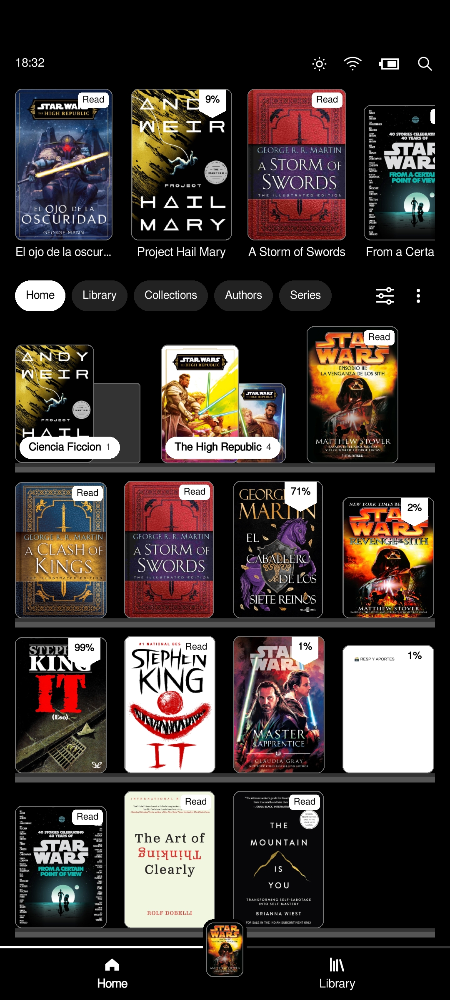
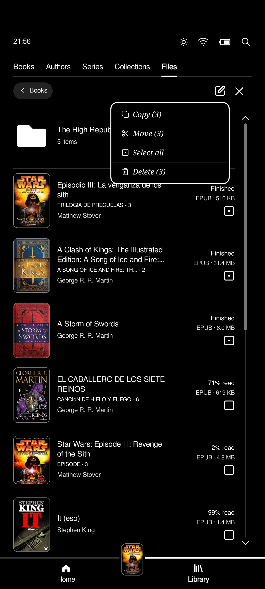
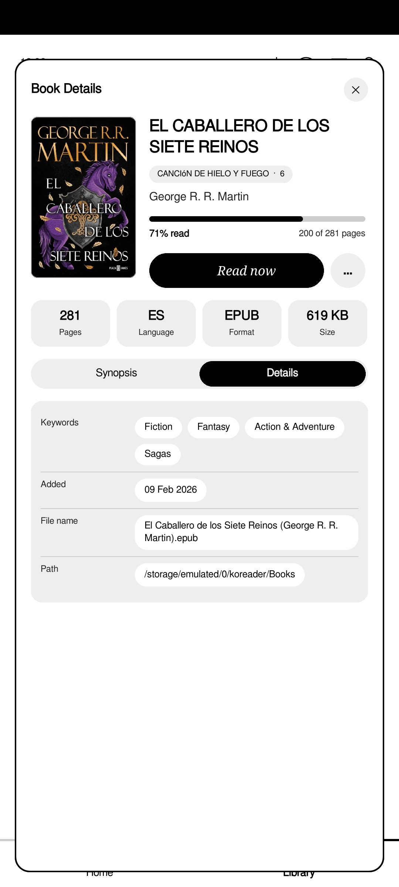

# KiKome Scrubber UI

Based on [Kobold](https://github.com/unitreign/kobold), KiKome is a mix of Kindle and Kobo for KOReader. A calm Home. A library that feels like yours. Everything a little rounder, a little quieter.

<table align="center" width="100%">
  <tr>
    <td align="center" width="25%" valign="top">
       
      <b>Home: List View</b>
    </td>
    <td align="center" width="25%" valign="top">
       
      <b>Home: Grid View</b>
    </td>
    <td align="center" width="25%" valign="top">
       
      <b>Library</b>
    </td>
    <td align="center" width="25%" valign="top">
       
      <b>Book Details</b>
    </td>
  </tr>
</table>

---

## Home

Your recent books, front and center. Swipe through them, pick up where you left off, and see your reading at a glance. 

## Library

This is where your books live, and where you shape them.

Browse by **Books**, **Authors**, **Series**, **Collections**, or **Files**. Filter, sort, and switch between list and grid in a tap.

The **Files** tab is the one to explore. Open any folder, hold a book for its menu, and use **More** for:

- **Select** books, one or many.
- **Copy** or **Move** them, then open a folder and **Paste here**. Progress, history, and covers come along.
- **Delete** what you no longer need, along with its reading progress.
- Make a **New Folder** anywhere.

## Settings

Choose how books open, which menu you see, how many rows fit on a page, and how the status bar looks. It's all under **Settings**, in **More**.

## Install

1. Copy the `.koplugin` folder into `koreader/plugins`.
2. Restart KOReader.
3. Open the main menu, go to **Start with**, and choose **KiKome**.

## License

GPL-3.0, like the project it grew from. See `LICENSE`.

---

## Thank you

To [Kobold](https://github.com/unitreign/kobold), for the foundation.

To [Bookshelf](https://github.com/AndyHazz/bookshelf.koplugin), for the way books move between folders and the inspiration of the shelves in home.
